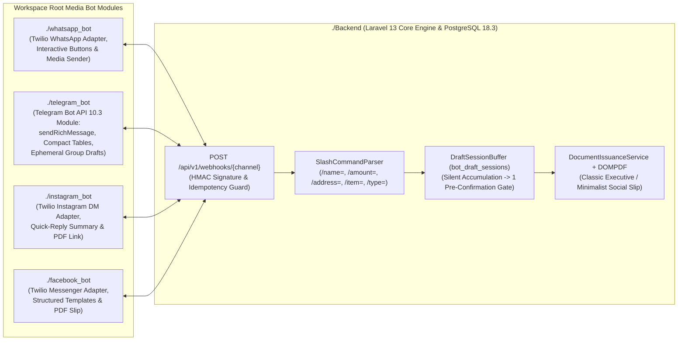

# NetSlip — Master System Architecture, Flutterwave/Paystack UI/UX Design System, Component Library & Omnichannel Bot Blueprint
> **Brand Tagline:** *"Close the sale. Send the slip."*  
> **Project Workspace:** `c:\Users\rufus.otolorin\Documents\Ampps\netSlip`  
> **Verified Progressive Stack (6-Year Horizon):**  
> - **Backend & Admin/Super-Admin Fullstack (`./Backend`)**: **PHP 8.5.12 NTS** + **Laravel 13 (`^13.17`)** + **PostgreSQL 18.3** + **Strict Typing (`declare(strict_types=1)`, Spatie Laravel Data, TypeScript Transformer, Larastan Level 8, Laravel Pint)**  
> - **Public Website & Business/Merchant Dashboard (`./Frontend`)**: **React 19 (`^19.3.1`)** + **Vite 8 (`^8.3.4`)** + **TypeScript 6 (`~6.0.3`)** + **Tailwind CSS v4 (`^4.3.3`)** + **Zustand (`^5.0.16`) + Immer** + **TanStack React Query (`^5.104.5`)** + **React Hook Form + Zod (`^4.6.7`)**  
> - **Dedicated Media Bot Modules**: `./whatsapp_bot`, `./telegram_bot`, `./instagram_bot`, `./facebook_bot`  
> **Compliance & API Standard:** OWASP ASVS Level 2 · ISO 27001 Controls · NDPA / GDPR · IFRS / International Accounting Standards · Telegram Bot API 10.3 (Aug 24, 2026) · Twilio Programmable Messaging API

---

## 1. Purpose of This Master Document (For Developers & AI Agents)

This document is the **Single Source of Truth (SSOT)** for the **NetSlip** platform. Any developer or AI coding agent working in `c:\Users\rufus.otolorin\Documents\Ampps\netSlip` **MUST** read and follow this specification before writing or modifying code across `Backend/`, `Frontend/`, or the 4 bot directories (`whatsapp_bot/`, `telegram_bot/`, `instagram_bot/`, `facebook_bot/`).

### Core Architectural Golden Rules
1. **Flutterwave & Paystack Clean Fintech UI/UX (Zero Generic AI Clutter)**:
   * All public-facing pages (`Landing`, `How It Works`, `Pricing`, `About`, `Verify Slip`, `Invoice Checkout`) and dashboards must follow the **Paystack / Flutterwave** design philosophy: **generous whitespace, visual interactive product previews instead of walls of text, punchy human micro-copy (max 6–8 word headlines, max 15-word subtext), crisp 1px borders, and high-trust fintech clarity**.
   * Do **NOT** copy the verbose, robotic AI paragraphs or fake jargon from `./google_stitch_ui_ux` (see Section 4 for the exact Stitch Audit Matrix).
2. **Maximized Reusable Component Architecture (DRY UI across React & Laravel)**:
   * Never write ad-hoc inline Tailwind utility chains repeatedly for buttons, status badges, cards, typography, colors, or responsive containers.
   * **React TypeScript (`./Frontend`)** uses strictly typed, centralized UI primitives in `Frontend/src/components/ui/*`.
   * **Laravel Admin & Super-Admin (`./Backend`)** mirrors the exact same design system using reusable Blade/Livewire components in `Backend/resources/views/components/ui/*`.
3. **Omnichannel Cost Optimization**:
   * Vendors can send `/name = ...`, `/amount = ...`, `/address = ...`, `/item = ...`, `/type = receipt|invoice` either **one-by-one** or **all in one message**.
   * On **WhatsApp, Instagram, and Facebook (`whatsapp_bot/`, `instagram_bot/`, `facebook_bot/`)**, partial messages are buffered silently in PostgreSQL (`bot_draft_sessions`) and only trigger **one** consolidated pre-confirmation reply before generating the PDF—eliminating wasted Twilio/Meta per-message fees.
   * On **Telegram (`telegram_bot/`)**, the bot leverages **Telegram Bot API 10.3 (August 24, 2026)** (`sendRichMessage`, `InputRichBlockTable`, `EphemeralMessageParameters`, `DisabledButton`, `sendRichMessageDraft`).

---

## 2. Complete Workspace Directory Map

```text
c:\Users\rufus.otolorin\Documents\Ampps\netSlip\
├── ARCHITECTURE_AND_PLAN.md                 # THIS FILE — Master Architecture, UI/UX & Component Blueprint
├── GOOGLE_STITCH_UI_UX_PROMPT.md            # Historical Stitch prompt reference
│
├── brand_identity/                          # Official NetSlip Brand Assets (Source of Truth)
│   ├── Brand Guide.jpg                      # Official color palette (#377581, #265363) & typography rules
│   ├── Netslip PNG.png                      # Official transparent PNG logo (Icon N + Checkmark Slip)
│   ├── NETSLIP LOGO RAW.psd                 # Master Photoshop source file
│   ├── DP 1.jpg & Netslip Mock 1-4.jpg      # Official brand mockups
│   ├── Lupio-Font-Family-/Demo_Fonts/*.otf  # Official Primary Font Family (Thin to Black + Italics)
│   └── Brush Script MT/BRUSHSCI.TTF         # Official Secondary Accent Font (Tagline & Signatures)
│
├── google_stitch_ui_ux/                     # Exported Visual Reference Wireframes (See Section 4 Audit!)
│   ├── stitch_netslip_invoice_saas/         # Export 1: Merchant Dashboard, Composer, Ledger, Templates, Admin
│   └── stitch_netslip_invoice_saas_second_export/ # Export 2: Public Pages, Checkout, Verification, Editorial Photos
│
├── Backend/                                 # Laravel 13 (PHP 8.5.12) API + Admin/Super-Admin Fullstack Portal
│   ├── app/
│   │   ├── Actions/                         # Single-responsibility strongly-typed domain actions
│   │   ├── Data/                            # Spatie Laravel Data DTOs (auto-exported to React TS types)
│   │   ├── Enums/                           # PHP 8.5 Backed Enums (DocumentStatus, MutabilityMode, PlanTier, etc.)
│   │   ├── Http/Controllers/
│   │   │   ├── Api/V1/                      # REST endpoints for React Merchant SPA & Bot Webhooks
│   │   │   └── Admin/                       # Fullstack Laravel Controllers for Admin & Super-Admin (/admin/*)
│   │   ├── Models/                          # Eloquent Models with PostgreSQL RLS & Audit Revisions
│   │   ├── Policies/                        # RBAC & Per-Client Mutability Guard (DocumentPolicy)
│   │   └── Services/                        # Accounting, PDF/QR Renderer, Payment Gateways, Bot Orchestrator
│   ├── resources/views/
│   │   ├── components/ui/                   # Reusable Laravel Blade UI Component Library (<x-ui.*>)
│   │   ├── admin/                           # Admin & Super-Admin Portal Views
│   │   └── pdf/templates/                   # DOMPDF Slip Templates (Classic Executive, Minimalist Social, Custom)
│   └── .env                                 # Configured for PostgreSQL 18.3 (netslip_db, postgres/postgresql)
│
├── Frontend/                                # React 19 + Vite 8 + TypeScript 6 + Tailwind v4 SPA
│   ├── public/assets/                       # Copied Lupio & Brush Script MT fonts + NetSlip logos
│   └── src/
│       ├── components/
│       │   ├── ui/                          # Reusable Atomic UI Components (Button, Badge, Card, Text, Table, etc.)
│       │   ├── layout/                      # PublicNavbar, PublicFooter, DashboardSidebar, Topbar, Container
│       │   └── slip/                        # LivePaperSlipPreview, QRVerificationStamp, SlashCommandBar
│       ├── pages/
│       │   ├── public/                      # Flutterwave/Paystack-style Landing, HowItWorks, Pricing, Verify, Pay
│       │   ├── auth/                        # Login, Register, Verify2FA, AcceptInvite
│       │   └── dashboard/                   # Overview, Composer, Documents, Templates, Customers, Inventory, etc.
│       ├── stores/                          # Zustand + Immer State Stores (auth, composerDraft, theme, ui)
│       ├── hooks/                           # TanStack React Query API hooks & responsive breakpoint hooks
│       └── types/                           # Auto-generated TypeScript interfaces from Laravel Data DTOs
│
├── whatsapp_bot/                            # Dedicated WhatsApp Bot Module (Twilio Programmable Messaging)
├── telegram_bot/                            # Dedicated Telegram Bot Module (Telegram Bot API 10.3 - Aug 24, 2026)
├── instagram_bot/                           # Dedicated Instagram DM Bot Module (Twilio Programmable Messaging)
└── facebook_bot/                            # Dedicated Facebook Messenger Bot Module (Twilio Programmable Messaging)
```

---

## 3. Official Brand Identity System (from `./brand_identity`)

Every screen in `Frontend/` (React TS), `Backend/` (Laravel Blade Admin), and the PDF Slip Engine must strictly enforce the brand tokens in `c:\Users\rufus.otolorin\Documents\Ampps\netSlip\brand_identity`:

| Design Token | Value / Asset File | Technical Binding in React TS & Laravel Blade |
| :--- | :--- | :--- |
| **Brand Name** | **NetSlip** | Application title, bot display name, PDF watermark |
| **Brand Tagline** | *"Close the sale. Send the slip"* | Rendered in **Brush Script MT** on hero accents, auth cards, and receipt footers |
| **Primary Brand Teal** | `#377581` (`rgb(55, 117, 129)`) | `--color-netslip-primary: #377581` (`bg-netslip-primary`, `text-netslip-primary`, `border-netslip-primary`) |
| **Primary Teal Hover** | `#2E636E` (`rgb(46, 99, 110)`) | `--color-netslip-primary-hover: #2E636E` |
| **Primary Teal Soft Tint** | `#EAF2F4` (`rgb(234, 242, 244)`) | `--color-netslip-tint: #EAF2F4` — Subtle pill backgrounds, active sidebar row highlight |
| **Deep Slate Teal** | `#265363` (`rgb(38, 83, 99)`) | `--color-netslip-deep: #265363` (`bg-netslip-deep`, `text-netslip-deep`) — Sidebars, executive hero cards, dark banners |
| **Deep Teal Darkest** | `#163540` (`rgb(22, 53, 64)`) | `--color-netslip-obsidian: #163540` — Super-Admin header, footer surface, high-contrast code/command bars |
| **Primary Font Family** | **Lupio** (`Thin` 100 to `Black` 900) | `--font-sans: 'Lupio', sans-serif` — Used for **100% of headings, body text, buttons, tables, and KPIs** |
| **Accent Script Font** | **Brush Script MT** (`BRUSHSCI.TTF`) | `--font-script: 'Brush Script MT', cursive` — Used **exclusively** for *"Close the sale. Send the slip"* and receipt digital signature accents (never for body copy or tables) |
| **Monospace / Financial Font** | `JetBrains Mono` / System Mono + `tabular-nums` | `--font-mono` — Used for `/slash =` command bars, document numbers (`RCP-2026-0001`), and cryptographic SHA-256 hashes |

---

## 4. Flutterwave & Paystack UI/UX Standard vs. Google Stitch Exports Audit

### 4.1 Why We Are Overhauling the Google Stitch Public Pages
The user exported reference designs from Google Stitch into:
1. `c:\Users\rufus.otolorin\Documents\Ampps\netSlip\google_stitch_ui_ux\stitch_netslip_invoice_saas`
2. `c:\Users\rufus.otolorin\Documents\Ampps\netSlip\google_stitch_ui_ux\stitch_netslip_invoice_saas_second_export`

While Stitch produced useful dashboard wireframes and tactile paper-slip layouts, its public-facing pages (`Landing`, `About`, `How It Works`, `Pricing`, `Security`) suffer from **classic AI-generated UI/UX flaws** that we **MUST ERADICATE**:
* ❌ **Too Much Text / Wordy Paragraphs**: Stitch filled every section with 30–50 word paragraphs that real merchants will never read.
* ❌ **Robotic AI Buzzwords**: Terms like *"Forensic Commerce Comparison"*, *"Bespoke Artisan Guarantee"*, *"Regulatory Dossier"*, *"Immutable Protocol"*, and *"Velocity Matrix"* feel artificial and alienating.
* ❌ **Font Drift**: Stitch injected `Plus Jakarta Sans` and random serif fonts instead of strictly using **Lupio**.
* ❌ **Visual Bugs in Export**: `netslip_slash_composer_live_paper_slip_preview` had raw Base64 text overlapping the slip header.

### 4.2 The Paystack & Flutterwave Clean Fintech Design Rules (Mandatory)
Every page in NetSlip must feel like **Paystack** (`paystack.com`) and **Flutterwave** (`flutterwave.com`):
1. **Strict Copywriting Cap (Zero Text Walls)**:
   * **Hero & Section Titles**: **4 to 8 words maximum**, bold, clear, and benefit-driven.
     * *Bad (Stitch AI)*: `"Architectural Financial Infrastructure for Omnichannel Social Commerce Merchants"`
     * *Good (Paystack/Flutterwave Style)*: `"Turn chat orders into instant receipts."` / `"Close the sale. Send the slip."`
   * **Section Subtitles**: **12 to 18 words maximum** (max 2 lines on desktop).
   * **Feature Cards**: **Icon + 3-word Title + 1-sentence description (max 12 words)**. Never put multi-paragraph essays inside cards.
2. **Show, Don't Tell (Interactive Visual Micro-Demos Instead of Text)**:
   * **Hero Section**: Left column has a punchy 6-word headline, 1-sentence subtitle, 2 CTA buttons (`Start Free — 15 Slips/Mo` & `Try Live Demo`), and channel logos (`WhatsApp`, `Telegram`, `Instagram`, `Facebook`). Right column displays an **interactive live `/slash` chat-to-receipt animation** where clicking a sample chat message instantly morphs into a crisp NetSlip receipt card.
   * **How It Works Section**: Just **3 visual step cards** (`1. Type /slash in chat` $\rightarrow$ `2. Confirm 1-msg summary` $\rightarrow$ `3. Share branded PDF slip`) with clean UI snippets—zero long explanations.
3. **Generous Whitespace & Breathable Grid Architecture**:
   * Public sections use `py-20 lg:py-28` vertical spacing and `max-w-7xl mx-auto px-4 sm:px-6 lg:px-8`.
   * Background alternates cleanly between **Pure White (`#FFFFFF`)**, **Cool Porcelain Slate (`#F8FAFC`)**, and a single high-impact **Deep Slate Teal (`#265363`)** CTA banner.
   * Cards use `rounded-2xl` (`16px`) on public pages and `rounded-xl` (`12px`) on dense dashboard tables, with `1px solid #E2E8F0` borders and subtle hover lift (`hover:-translate-y-0.5 transition-all duration-200`).

### 4.3 Audit Matrix: What to Keep vs. Replace from `./google_stitch_ui_ux`

| Stitch Export Folder / Screen | What to Salvage (Layout / Assets) | What to Eradicate & Replace (Paystack/Flutterwave Overhaul) |
| :--- | :--- | :--- |
| `stitch_netslip_invoice_saas_second_export/netslip_turn_chat_orders_into_cryptographic_receipts` | • 2-column hero split concept (chat bubble feeding into paper receipt card).<br>• Editorial merchant photos (`unnamed.png`, `unnamed (1).png`) for social proof cards. | • **Delete** 60% of the text paragraphs.<br>• **Delete** *"Forensic Commerce Comparison"* table.<br>• **Replace** with Paystack-style 3-card feature bento grid + interactive live `/slash` playground. |
| `stitch_netslip_invoice_saas_second_export/netslip_how_it_works` | • 3-step horizontal progression concept (`Input` $\rightarrow$ `Pre-Confirmation Buffer` $\rightarrow$ `PDF Slip`). | • **Delete** verbose technical essays under each step.<br>• **Replace** with visual WhatsApp & Telegram 10.3 UI mockups and a 12-word caption per step. |
| `stitch_netslip_invoice_saas_second_export/netslip_transparent_pricing_non_expiring_packs` | • 3-tier pricing card grid (`Free ₦0`, `Pro ₦2,500`, `Business Plus ₦6,000`) + PAYG Credit Pack banner (`₦1,000 / 50 credits`). | • **Clean up** card density: use crisp checkmark lists (max 5–6 bullet points per tier), Monthly/Yearly toggle pill (`Save 20%`), and Flutterwave + Crypto payment badges. |
| `stitch_netslip_invoice_saas_second_export/netslip_about_us_leadership_team` & `ledger_security_verification` | • Trust badges and QR verification preview concept. | • **Consolidate & trim**: Replace generic AI fake team bios and "Regulatory Dossier" text with concise, authentic merchant trust metrics, security badges (HMAC-SHA256, AES-256, RLS), and an interactive **"Verify a Receipt Number"** lookup input. |
| `stitch_netslip_invoice_saas/netslip_executive_overview` & `overview_analytics` | • 4-card KPI top row + Revenue Area Chart + Channel Donut + Recent Ledger rows. | • **Standardize** into reusable `<StatCard />` and `<Card />` React components with strict **Lupio** typography and `tabular-nums`. |
| `stitch_netslip_invoice_saas/netslip_slash_composer_live_paper_slip_preview` | • 50/50 split-pane layout (Left: `/slash` command bar & visual form; Right: Live Paper Slip preview with torn/perforated edge & QR stamp). | • **Fix** the broken Base64 header bug from the Stitch screenshot.<br>• Bind live state to **Zustand + Immer** so typing `/name = ...` updates the paper slip in $<16\text{ms}$. |
| `stitch_netslip_invoice_saas/netslip_receipts_invoices_credit_notes_ledger` | • Filterable status tabs + row action menu + Immutable/Mutable badge indicator. | • Build with our reusable `<DataTable />` and `<StatusBadge />` components. |
| `stitch_netslip_invoice_saas/netslip_super_admin_admin_control_portal` | • Dark `#265363` sidebar + Per-Client Mutability Control card + Live Pricing & Template Studio layout. | • Build in **Laravel 13 (`Backend/`)** using our reusable `<x-ui.*>` Blade component library. |

---

## 5. Maximized Reusable Component System (React TS `Frontend/` & Laravel Fullstack `Backend/`)

To guarantee visual consistency, rapid development, and zero duplicated CSS across both the **Merchant React SPA (`Frontend/`)** and the **Admin/Super-Admin Laravel Portal (`Backend/`)**, all UI elements are built as **reusable, parameterized components**.

### 5.1 Shared Design Tokens (`class: colour`, `fonts`, `screen size`)

Both `Frontend/src/index.css` (Tailwind CSS v4 `@theme`) and `Backend/resources/css/app.css` define the exact same CSS variables and utility classes:

#### A. Color Tokens (`class: colour`)
| Token Category | Token Name / Utility Class | Hex Value | Usage Across React & Laravel |
| :--- | :--- | :--- | :--- |
| **Brand Core** | `netslip-primary` (`bg-netslip-primary`, `text-netslip-primary`) | `#377581` | Primary buttons, active navigation indicators, links, focus rings, brand accents |
| **Brand Hover** | `netslip-primary-hover` (`hover:bg-netslip-primary-hover`) | `#2E636E` | Primary CTA hover state |
| **Brand Deep** | `netslip-deep` (`bg-netslip-deep`, `text-netslip-deep`) | `#265363` | Dashboard sidebar, executive summary banner, table header emphasis |
| **Brand Tint** | `netslip-tint` (`bg-netslip-tint`, `text-netslip-deep`) | `#EAF2F4` | Soft badge backgrounds, selected card backgrounds, subtle icon containers |
| **Canvas & Cards** | `surface-canvas` / `surface-card` / `surface-subtle` | `#F8FAFC` / `#FFFFFF` / `#F1F5F9` | Page background (`#F8FAFC`), elevated cards (`#FFFFFF`), muted wells (`#F1F5F9`) |
| **Text Hierarchy** | `ink-primary` / `ink-secondary` / `ink-muted` | `#0F172A` / `#475569` / `#94A3B8` | Headings & amounts (`#0F172A`), body copy (`#475569`), captions & placeholders (`#94A3B8`) |
| **Border Hairline** | `border-subtle` / `border-focus` | `#E2E8F0` / `#377581` | Crisp 1px card/table borders (`#E2E8F0`), input focus ring (`#377581`) |
| **Status: Paid / Active** | `status-paid` (`bg-emerald-50 text-emerald-700 border-emerald-200`) | `#10B981` | Settled receipts, active webhooks, verified cryptographic signatures |
| **Status: Partial / Pending**| `status-partial` (`bg-amber-50 text-amber-700 border-amber-200`) | `#F59E0B` | Partially paid invoices, awaiting confirmation drafts, low stock warning |
| **Status: Unpaid / Overdue** | `status-unpaid` (`bg-rose-50 text-rose-700 border-rose-200`) | `#EF4444` | Overdue invoices, failed webhooks, suspended accounts |
| **Status: Draft / Void** | `status-draft` (`bg-slate-100 text-slate-600 border-slate-200`) | `#64748B` | Unissued drafts, voided documents, disabled buttons |
| **Mutability: Immutable** | `status-immutable` (`bg-teal-50 text-netslip-deep border-teal-200`)| `#265363` | Locked ledger records (`🔒 Immutable`) |
| **Mutability: Mutable** | `status-mutable` (`bg-sky-50 text-sky-700 border-sky-200`) | `#0284C7` | Editable ledger records (`✏️ Mutable · Audited`) |

#### B. Responsive Screen Size Breakpoints (`screen size`)
Every layout component enforces mobile-first responsiveness for merchants operating on smartphones, tablets, laptops, and ultrawide monitors:
| Breakpoint Token | Min-Width | Target Device Class | Grid & Layout Behavior |
| :--- | :--- | :--- | :--- |
| `default` (`xs`) | `0px` (`360px+`) | Mobile Phones (iPhone / Android) | Single-column stack (`grid-cols-1`), collapsible bottom-sheet preview for slip composer, swipeable horizontal tables, compact `px-4` padding |
| `sm` | `640px` | Large Phones / Phablets | 2-column KPI summary cards (` sm:grid-cols-2`), `px-6` container padding |
| `md` | `768px` | Tablets (iPad Mini / Portrait) | 2-column feature grids (`md:grid-cols-2`), persistent collapsible sidebar drawer |
| `lg` | `1024px` | Laptops & Desktops | Fixed `260px` sidebar + main workspace, 4-column KPI row (`lg:grid-cols-4`), 50/50 split-pane Slip Composer (`lg:grid-cols-12`) |
| `xl` | `1280px` | Large Desktops | `max-w-7xl` public container, spacious table columns without horizontal scroll |
| `2xl` | `1536px` | Ultrawide Monitors | Centered max-width container (`max-w-[1440px]`) preventing overly stretched lines |

---

### 5.2 Complete Component Catalog (React TypeScript vs. Laravel Blade)

Every UI primitive exists in both **React TypeScript (`Frontend/src/components/ui/`)** and **Laravel Blade (`Backend/resources/views/components/ui/`)** with matching prop/attribute APIs:

| # | Component Category | React TypeScript Component (`Frontend/src/components/ui/*`) | Laravel Fullstack Blade Component (`Backend/resources/views/components/ui/*`) | Supported Variants, Sizes & Props |
| :--- | :--- | :--- | :--- | :--- |
| **1** | **Typography & Text (`text`, `fonts`)** | `<Heading level={1..6} variant="display\|section\|card\|script" />`<br>`<Text variant="body\|lead\|small\|caption\|mono" tone="primary\|secondary\|muted\|brand" />` | `<x-ui.heading :level="1" variant="section">`<br>`<x-ui.text variant="body" tone="secondary">` | • Automatically applies **Lupio** weights (`font-extrabold`, `font-semibold`, `font-normal`), **Brush Script MT** for `variant="script"`, and `tabular-nums` for financial/numeric text.<br>• Enforces line-clamp and max-width (`max-w-prose`) for readability. |
| **2** | **Status Display & Badges (`status display`)** | `<StatusBadge status="PAID\|PARTIAL\|UNPAID\|OVERDUE\|DRAFT\|VOID\|IMMUTABLE\|MUTABLE_WITH_AUDIT" size="sm\|md" showDot showIcon />` | `<x-ui.status-badge :status="$doc->status" size="md" :show-dot="true" />` | • Automatically maps any PHP Backed Enum or TS Union status to its exact semantic color pill, pulsing status dot, and Lucide/SVG icon (`CheckCircle2`, `Clock`, `AlertTriangle`, `Lock`, `FileEdit`).<br>• Also supports Channel Badges (`WHATSAPP`, `TELEGRAM`, `INSTAGRAM`, `FACEBOOK`). |
| **3** | **Buttons & CTAs (`buttons`)** | `<Button variant="primary\|deep\|secondary\|outline\|ghost\|danger\|success" size="xs\|sm\|md\|lg" isLoading leftIcon rightIcon fullWidth />`<br>`<IconButton icon={...} label="..." />` | `<x-ui.button variant="primary" size="md" :loading="false" icon="plus">`<br>`<x-ui.icon-button icon="edit" label="Edit" />` | • `primary`: `#377581` fill + white text + subtle shadow.<br>• `deep`: `#265363` fill + white text.<br>• `secondary`: `#EAF2F4` teal tint + `#265363` text.<br>• `outline`: `1px solid #CBD5E1` + hover `#F8FAFC`.<br>• Built-in spinner when `isLoading` is true; auto-disables to prevent double-clicks. |
| **4** | **Cards & Containers (`cards`)** | `<Card variant="default\|elevated\|deep\|tinted\|interactive\|paper-slip" padding="none\|sm\|md\|lg" />`<br>`<StatCard title="..." value="..." trend="+14%" icon={...} />` | `<x-ui.card variant="default" padding="md">`<br>`<x-ui.stat-card title="Total MRR" :value="$mrr" trend="+12%" />` | • `default`: White `#FFFFFF` + `1px solid #E2E8F0` + `rounded-xl`.<br>• `elevated`: Paystack-style soft shadow + `rounded-2xl`.<br>• `deep`: `#265363` gradient card for executive KPIs/credit balance.<br>• `paper-slip`: Tactile receipt card with top brand bar, serrated bottom edge, and watermark overlay. |
| **5** | **Responsive Screen Containers (`screen size`)** | `<Container size="sm\|md\|lg\|xl\|full" />`<br>`<PageHeader title="..." subtitle="..." actions={...} />`<br>`<SplitWorkspace left={...} right={...} />` | `<x-ui.container size="xl">`<br>`<x-ui.page-header title="Merchants" subtitle="...">` | • Centralizes responsive padding (`px-4 sm:px-6 lg:px-8`), max-widths, and mobile-to-desktop grid transitions so individual pages never hardcode layout wrappers. |
| **6** | **Money & Minor-Unit Formatter** | `<Money amountMinor={1500000} currency="NGN" size="sm\|md\|lg\|xl" />` | `<x-ui.money :amount-minor="1500000" currency="NGN" size="lg" />` | • Converts integer minor units (`1500000` Kobo $\rightarrow$ `₦15,000.00`) using `Intl.NumberFormat` / PHP `NumberFormatter` with strict `tabular-nums` alignment. |
| **7** | **Form Inputs & Slash Bar** | `<Input label="..." error="..." helperText="..." prefixIcon={...} />`<br>`<Select />` · `<ToggleSwitch />`<br>`<SlashCommandInput value="..." onChange={...} />` | `<x-ui.input name="..." label="..." :error="$errors->first(...)" />`<br>`<x-ui.select />` · `<x-ui.toggle />` | • Unified accessible label, focus ring (`ring-2 ring-netslip-primary/20 border-netslip-primary`), inline validation error state, and syntax-highlighted `/key = value` pill hints. |
| **8** | **Data Tables & Pagination** | `<DataTable columns={...} data={...} isLoading emptyState={...} pagination={...} />` | `<x-ui.data-table :headers="[...]" :paginator="$records">` | • Sticky header, row hover highlight, mobile card-collapse option, skeleton loader rows, and clean empty states with a primary CTA button. |
| **9** | **Modals, Drawers & Confirmations** | `<Modal isOpen onClose title="..." size="sm\|md\|lg" />`<br>`<Drawer isOpen onClose position="right" />` | `<x-ui.modal id="..." title="..." size="md">`<br>`<x-ui.drawer id="..." title="...">` | • Used for **Mutable Document Edit (with mandatory Reason field)**, **Forensic Revision Diff Viewer**, **Record Payment**, and **Credit Pack Checkout**. |

---

## 6. Dedicated Media Bot Folders Architecture (`whatsapp_bot`, `telegram_bot`, `instagram_bot`, `facebook_bot`)

You created four dedicated media bot folders at the workspace root. To ensure clean modular separation while sharing the **Laravel 13 (`Backend/`)** database, accounting ledger, and DOMPDF template engine, here is the exact architecture and responsibility of each folder:



### 6.1 How the 4 Bot Folders Are Structured & Connected to `Backend/`
Each of the 4 bot directories (`whatsapp_bot/`, `telegram_bot/`, `instagram_bot/`, `facebook_bot/`) is registered in `Backend/composer.json` via PSR-4 autoloading (`NetSlip\Bots\WhatsApp\`, `NetSlip\Bots\Telegram\`, `NetSlip\Bots\Instagram\`, `NetSlip\Bots\Facebook\`) AND contains its own self-contained configuration, channel webhook validator, payload builder, slash-command normalizer, and developer README:

| Bot Folder | Namespace & Core Files | Channel-Specific Protocol & Cost-Optimization Responsibilities |
| :--- | :--- | :--- |
| **`./whatsapp_bot/`** | `NetSlip\Bots\WhatsApp\`<br>• `WhatsAppWebhookHandler.php`<br>• `WhatsAppPayloadBuilder.php`<br>• `WhatsAppInteractiveSummary.php`<br>• `config.php` & `README.md` | • Validates `X-Twilio-Signature` for `whatsapp:+234...` messages.<br>• Silently buffers sequential `/name =`, `/address =`, `/item =` messages by returning an empty `<Response/>` TwiML (`₦0` outbound cost).<br>• Once minimum fields (`name` + `amount`/`item`) are present, sends **1 consolidated WhatsApp Interactive Quick-Reply message** (`[✅ Confirm & Generate]` / `[✏️ Edit]` / `[❌ Cancel]`) inside the free 24-hour customer service window.<br>• Delivers the generated PDF slip via Twilio `mediaUrl` + verification link. |
| **`./telegram_bot/`** | `NetSlip\Bots\Telegram\`<br>• `Telegram103WebhookHandler.php`<br>• `TelegramRichMessageBuilder.php`<br>• `TelegramEphemeralDraftService.php`<br>• `config.php` & `README.md` | • Strictly implements **Telegram Bot API 10.3 (August 24, 2026)**:<br>  1. `sendRichMessage` with `InputRichBlockTable` (`is_compact: true`) for itemized receipt previews.<br>  2. `InputRichBlockDocument` (`tg://document?id=...`) to embed the generated PDF slip natively inside the rich message.<br>  3. `InputRichBlockExpandableBlockQuotation` for compact bank details & audit hashes.<br>  4. `EphemeralMessageParameters` (`replace_callback_query_message: true`) so group-chat drafts are visible only to the sales agent.<br>  5. `DisabledButton` (`InlineKeyboardButton.disabled = true`) after tapping Confirm to prevent double credit deduction.<br>  6. `sendRichMessageDraft` (`can_stop`, `keep_on_stop`) while rendering the PDF. |
| **`./instagram_bot/`** | `NetSlip\Bots\Instagram\`<br>• `InstagramWebhookHandler.php`<br>• `InstagramPayloadBuilder.php`<br>• `config.php` & `README.md` | • Handles Twilio Programmable Messaging for Instagram (`ig:...` / `instagram:...`).<br>• Supports both single-message (`/name = ..., /amount = ..., /item = ...`) and multi-message silent draft buffering.<br>• Sends a concise pre-confirmation summary card with Quick-Reply payloads and delivers the branded receipt preview image + signed PDF download/verification link. |
| **`./facebook_bot/`** | `NetSlip\Bots\Facebook\`<br>• `FacebookMessengerWebhookHandler.php`<br>• `FacebookPayloadBuilder.php`<br>• `config.php` & `README.md` | • Handles Twilio Programmable Messaging for Facebook Messenger (`messenger:...`).<br>• Supports single-shot or multi-message `/slash` commands with silent draft accumulation.<br>• Sends consolidated confirmation prompt and delivers the PDF receipt/invoice attachment + hosted payment link (`/pay/{uid}`) for unpaid invoices. |

---

## 7. Verified Technology Stack Matrix (Installed & Configured Locally)

### 7.1 Backend Stack (`./Backend/composer.json` — Verified Installed)
| Package | Installed Version | Exact Role in NetSlip |
| :--- | :--- | :--- |
| **PHP Runtime** | **`8.5.12 NTS x64`** (`C:\php-8.5.12-nts-Win32-vs17-x64`) | Strict typing (`declare(strict_types=1)`), property hooks, asymmetric visibility, backed enums, `pdo_pgsql`, `pgsql`, `gd`, `intl`, `sodium`, `curl`, `mbstring`, `zip` |
| `laravel/framework` | **`^13.17`** | Core API, Queue, Scheduler, Eloquent ORM, Blade Component Engine for Admin Portal |
| `laravel/sanctum` | **`^4.3`** | Stateful SPA cookie authentication & API tokens for React 19 Merchant Dashboard |
| `spatie/laravel-permission` | **`^7.4`** | Multi-tenant RBAC (`SuperAdmin`, `Admin`, `Owner`, `Manager`, `SalesAgent`, `Accountant`) |
| `spatie/laravel-data` | **`^4.22`** | Strongly-typed PHP Data Transfer Objects (DTOs) & request validation |
| `spatie/laravel-typescript-transformer` | **`^2.6`** | Automatically transforms PHP DTOs & Backed Enums into `Frontend/src/types/generated.d.ts` |
| `barryvdh/laravel-dompdf` | **`^3.1`** | Sandboxed HTML/CSS to PDF 1.7 engine with local **Lupio** & **Brush Script MT** fonts |
| `twilio/sdk` | **`^8.13`** | Cryptographic webhook verification & messaging for `whatsapp_bot`, `instagram_bot`, `facebook_bot` |
| `chillerlan/php-qrcode` | **`^5.0`** | Dependency-free SVG/PNG QR code generator for tamper-evident slip verification |
| `larastan/larastan` & `laravel/pint` | **`^3.11` / `^1.29`** | Static analysis type-checking & automated strict code formatting |

### 7.2 Frontend Stack (`./Frontend/package.json` — Verified Installed, 0 Vulnerabilities)
| Package | Installed Version | Exact Role in NetSlip Public Site & Business Dashboard |
| :--- | :--- | :--- |
| `react` & `react-dom` | **`^19.3.1`** | Component-driven UI for Public Pages & Merchant Dashboard |
| `vite` & `typescript` | **`^8.3.4` / `~6.0.3`** | Ultra-fast HMR bundler & strict compile-time type safety |
| `tailwindcss` & `@tailwindcss/vite` | **`^4.3.3`** | CSS-first design token engine configured with NetSlip colors & Lupio fonts |
| `zustand` & `immer` | **`^5.0.16` / `^11.1.4`** | High-speed immutable client state management (Live `/slash` Composer, Auth, UI drawers) |
| `@tanstack/react-query` | **`^5.104.5`** | Server state caching, optimistic updates, and paginated ledger queries |
| `react-router-dom` | **`^7.15.2`** | Client-side routing across Public and `/dashboard/*` views |
| `react-hook-form`, `@hookform/resolvers`, `zod` | **`^7.73.1` / `^5.9.2` / `^4.6.7`** | Schema-validated forms with zero dependency vulnerabilities |
| `recharts` & `lucide-react` | **`^3.9.1` / `^1.17.0`** | Interactive financial charts & crisp vector iconography |
| `clsx` & `tailwind-merge` | **`^2.1.1` / `^3.5.0`** | Clean class composition inside reusable `Frontend/src/components/ui/*` components |

---

## 8. Complete Screen-by-Screen & Feature Specification

### 8.1 Portal A: Public & Customer-Facing Pages (React TS — Paystack/Flutterwave Aesthetic)
All public pages share `<PublicNavbar />`, `<PublicFooter />`, `<Container />`, `<Heading />`, `<Button />`, and `<Card />`, adhering to the **6–8 word headline cap** and **visual-first layout**:

| Route | Screen Name | Paystack / Flutterwave Visual Layout & Component Composition |
| :--- | :--- | :--- |
| `/` | **Clean Fintech Landing Page** | • **Hero**: 6-word Lupio ExtraBold headline (*"Turn chat orders into verified receipts."*), 14-word subtitle, Primary & Outline `<Button />`s, and an interactive **Live Chat-to-Slip Micro-Demo** (`WhatsApp / Telegram` message morphing into a `NetSlip Classic Executive` receipt).<br>• **Channel Strip**: Clean strip showing **WhatsApp · Telegram 10.3 · Instagram DM · Facebook Messenger**.<br>• **3-Card Bento Grid**: Visual cards (*Zero-Waste Draft Buffer*, *Instant Branded PDF*, *Cryptographic QR Proof*) with `<StatusBadge />` and 12-word captions.<br>• **Interactive Pricing Preview** & **Deep Teal CTA Banner**. |
| `/how-it-works` | **Visual 3-Step Flow** | • Replaces Stitch's wall of text with **3 interactive visual cards**:<br>  1. **Type `/slash` in Chat** (Single message or field-by-field).<br>  2. **1-Tap Summary Gate** (Saves Twilio/Meta API costs).<br>  3. **Send Verified PDF Slip** (With QR code & payment link). |
| `/pricing` | **Transparent Plans & PAYG Credits** | • Monthly / Yearly toggle (`Save 20%`) + 3 crisp `<Card />` tiers pulled from PostgreSQL:<br>  - **Free (`₦0/mo`)**: 15 receipts/mo, standard templates, `"Powered by NetSlip"` watermark.<br>  - **Pro Merchant (`₦2,500/mo` \| `₦24,000/yr`)**: Unlimited receipts & invoices, custom logo & brand colors, **no watermark**, automated WhatsApp/Telegram sales summaries, CSV/Excel export.<br>  - **Business Plus (`₦6,000/mo` \| `₦60,000/yr`)**: Multi-user staff RBAC, embedded Flutterwave & Crypto payment links, SKU inventory tracking, automated debt reminders.<br>• **Non-Expiring PAYG Credit Pack Banner (`₦1,000` for 50 credits)**: Clearly highlights that spending a paid credit **automatically removes the watermark**. |
| `/verify/:hash` | **Cryptographic Slip Verification Portal** | • Target of every PDF receipt/invoice QR code ( plus manual receipt number lookup).<br>• Renders an instant **Verified Authentic `<StatusBadge status="PAID" />`** (or Tamper Alert), Merchant Logo, Document Number, Customer Name, `<Money />` Total, Timestamp, and Mutability/Revision status. |
| `/pay/:doc_uid` | **Hosted Customer Invoice Checkout** | • Clean Paystack/Flutterwave-inspired payment card displaying the merchant's branded invoice.<br>• 1-click tabs: **Pay with Flutterwave (Card / Bank Transfer / USSD)** or **Pay with Crypto (NOWPayments: USDT TRC-20/BEP-20, USDC, BTC, TON)**.<br>• Auto-issues a linked Payment Receipt (`RCP`) upon webhook confirmation. |

### 8.2 Portal B: Business / Merchant User Dashboard (React TS SPA — `/dashboard/*`)
Built 100% with the reusable `Frontend/src/components/ui/*` library and Zustand + TanStack Query:

1. **Auth & Onboarding (`/login`, `/register`, `/verify-2fa`, `/dashboard/onboarding`)**:
   * Split-screen layout: Left form using `<Input />` & `<Button />`; Right `#265363` panel with live receipt preview and *"Close the sale. Send the slip"* in **Brush Script MT**.
   * 4-step Onboarding Wizard (Business & VAT Profile $\rightarrow$ Brand Logo, Colors & Default Template $\rightarrow$ Connect WhatsApp/Telegram/IG/FB $\rightarrow$ Select Plan or Credit Pack).
2. **Executive Overview (`/dashboard/overview`)**:
   * Top row of 4 `<StatCard />` components: **Settled Revenue**, **Unpaid Receivables**, **Remaining Quota / Non-Expiring Credits**, and **Messaging API Calls Saved**.
   * Recharts Revenue vs. Receivables Area Chart + Sales by Channel Donut (`WhatsApp`, `Telegram`, `Instagram`, `Facebook`, `Web`).
3. **Live Slash-Command & Visual Slip Composer (`/dashboard/composer`)**:
   * **Left Pane**: Toggle between **Slash Command Bar** (`/name = ..., /amount = ..., /address = ..., /item = 2x Shoe @ 15000`) and **Structured Form** (with SKU autocomplete, VAT Exclusive/Inclusive toggle, discount, shipping, amount paid).
   * **Right Pane**: Real-time `<PaperSlipCard />` preview backed by Zustand (`useComposerStore`) switching live between `Receipt` and `Invoice` and between templates.
4. **Receipts, Invoices & Credit Notes Ledger (`/dashboard/documents`)**:
   * Powered by `<DataTable />`, `<StatusBadge />`, and `<Money />`.
   * **Per-Client Mutability Enforcement**:
     * If Super-Admin set merchant to `IMMUTABLE`: Displays `<StatusBadge status="IMMUTABLE" />` (`🔒 Immutable Record`); blocks edits and provides 1-click **Issue Credit Note / Void**.
     * If Super-Admin set merchant to `MUTABLE_WITH_AUDIT` or `MUTABLE_UNRESTRICTED`: Displays `<Button variant="outline" size="xs">Edit</Button>`, opening a `<Modal />` that requires an edit reason and saves a forensic before/after snapshot in `document_revisions`.
5. **Template Gallery & Customizer (`/dashboard/templates`)**:
   * Previews the **2 Built-in Default Templates** (**`NetSlip Classic Executive`** & **`NetSlip Minimalist Social Slip`**) plus any custom templates added by Admin, with live toggle between Receipt and Invoice modes.
6. **Customers CRM & Debtors (`/dashboard/customers`)**, **SKU Inventory (`/dashboard/inventory`)**, **Staff RBAC (`/dashboard/team`)**, **Omnichannel Bot Hub (`/dashboard/channels`)**, and **Billing & PAYG Credits (`/dashboard/billing`)**.

### 8.3 Portal C: Admin & Super-Admin Fullstack Portal (Laravel 13 Blade — `/admin/*`)
Built in `Backend/resources/views/admin/*` using the reusable `<x-ui.*>` Blade components:

1. **Super-Admin Command Center (`/admin/dashboard`)**: Platform MRR/ARR, PAYG credit sales (Fiat vs. Crypto), active merchants per tier, channel volume, and queue health using `<x-ui.stat-card>` and `<x-ui.data-table>`.
2. **Client Management & Per-Client Ledger Mutability Controller (`/admin/merchants/{id}`)**:
   * Dedicated `<x-ui.card>` allowing Super-Admin/Admin to set each individual merchant's **Ledger Mutability Policy**:
     * `IMMUTABLE` (Default — Locked after issuance; Credit Notes/Voids only)
     * `MUTABLE_WITH_AUDIT` (Client can edit issued receipts/invoices in React dashboard; logs full before/after JSON diff + actor + IP + mandatory reason in `document_revisions`)
     * `MUTABLE_UNRESTRICTED` (Client can edit freely)
   * Includes `allow_staff_edits` toggle, `mutable_window_hours` input, and a **Forensic Revision Diff Drawer (`<x-ui.drawer>`)**.
3. **Admin Invoice & Receipt Template Studio (`/admin/templates`)**:
   * Manage the 2 seeded default templates (`NetSlip Classic Executive` & `NetSlip Minimalist Social Slip`) and create new HTML/CSS tokenized templates (`{{business_name}}`, `{{logo_url}}`, `{{primary_color}}`, `{{items_table}}`, `{{totals_block}}`, `{{qr_verification}}`, `{{watermark}}`).
4. **Dynamic Monetization & Pricing Engine (`/admin/monetization`)**:
   * Edit prices, quotas, and features for `Free`, `Pro Merchant`, and `Business Plus`, plus PAYG Credit Packs (`₦1,000 / 50 credits`) and the `remove_watermark_on_paid_credit` rule.
5. **Payment Gateways, Bot Credentials & Security Audit Logs (`/admin/gateways`, `/admin/security-logs`)**.

---

## 9. Core PostgreSQL 18.3 Schema & Accounting Integrity

Configured in `Backend/.env` (`DB_CONNECTION=pgsql`, `DB_HOST=127.0.0.1`, `DB_PORT=5432`, `DB_DATABASE=netslip_db`, `DB_USERNAME=postgres`, `DB_PASSWORD=postgresql`):

1. **`merchants`**: `id (UUID)`, `name`, `slug`, `currency (ISO 4217)`, `vat_rate_bps`, `vat_inclusive (bool)`, `primary_color (#377581)`, `secondary_color (#265363)`, `logo_path`, `default_receipt_template_id`, `default_invoice_template_id`, `plan_tier (FREE|PRO|BUSINESS_PLUS)`, `free_quota_used`, `paid_credits_balance`, **`record_mutability_mode (IMMUTABLE|MUTABLE_WITH_AUDIT|MUTABLE_UNRESTRICTED)`**, `allow_staff_edits`, `mutable_window_hours`, encrypted gateway keys.
2. **`templates`**: `id`, `slug`, `name` (`NetSlip Classic Executive`, `NetSlip Minimalist Social Slip`, etc.), `supports_receipt`, `supports_invoice`, `min_plan_tier`, `blade_view_or_html`, `default_tokens_json`, `is_active`.
3. **`bot_draft_sessions`**: `id (UUID)`, `merchant_id`, `actor_user_id`, `channel (WHATSAPP|TELEGRAM|INSTAGRAM|FACEBOOK)`, `external_chat_id`, `status (COLLECTING|AWAITING_CONFIRMATION|CONFIRMED|EXPIRED)`, `draft_payload_json`, `ephemeral_message_id`, `saved_outbound_calls_count`, `expires_at`.
4. **`documents`**: `id (UUID)`, `merchant_id`, `customer_id`, `template_id`, `doc_type (RECEIPT|INVOICE|CREDIT_NOTE)`, `doc_number` (`RCP-2026-0001` — gapless per-merchant sequence via `SELECT ... FOR UPDATE`), `parent_invoice_id`, `status (DRAFT|UNPAID|PARTIAL|PAID|OVERDUE|VOID)`, `currency`, **`subtotal_minor (BIGINT)`**, **`discount_minor (BIGINT)`**, **`tax_minor (BIGINT)`**, **`shipping_minor (BIGINT)`**, **`total_minor (BIGINT)`**, **`amount_paid_minor (BIGINT)`**, **`balance_due_minor (BIGINT)`**, `consumed_paid_credit (bool)`, `has_watermark (bool)`, `revision_number (INT)`, `verification_hash (HMAC-SHA256)`, `pdf_storage_path`, `issued_at`.
5. **`document_items`**: `id`, `document_id`, `sku_id`, `description`, `quantity`, `unit_price_minor (BIGINT)`, `line_total_minor (BIGINT)`.
6. **`document_revisions`**: `id`, `document_id`, `revision_number`, `actor_user_id`, `edit_reason`, `before_snapshot_json (JSONB)`, `after_snapshot_json (JSONB)`, `actor_ip`, `created_at`.
7. **`subscription_plans`, `credit_packs`, `payment_transactions`, `inventory_skus`, `customers`, `idempotency_keys`, `security_audit_logs`**.

---

## 10. Step-by-Step Agile Implementation Roadmap

When coding begins, execution follows these clean phases:
1. **Phase 1 — Design System, Fonts & Reusable UI Component Library (`Frontend/` & `Backend/`)**:
   * Copy official **Lupio** (`.otf`), **Brush Script MT** (`.ttf`), and **NetSlip Logos** from `./brand_identity` into `Frontend/public/assets/` and `Backend/public/assets/` + `Backend/storage/fonts/`.
   * Configure Tailwind v4 theme tokens (`#377581`, `#265363`, `Lupio`, `Brush Script MT`, semantic statuses, breakpoints) and build all reusable components in `Frontend/src/components/ui/*` and `Backend/resources/views/components/ui/*`.
2. **Phase 2 — Database Migrations, Enums, DTOs & Seeders (`Backend/`)**:
   * Run PostgreSQL 18.3 migrations for all tables, seed the 2 Default Templates (`NetSlip Classic Executive` & `NetSlip Minimalist Social Slip`), seed the Monetization Plans (`Free`, `Pro`, `Business Plus`) & PAYG Credit Pack (`₦1,000 / 50 credits`), and generate TypeScript definitions via `spatie/laravel-typescript-transformer`.
3. **Phase 3 — Core Accounting, DOMPDF Slip Renderer & Per-Client Mutability Engine (`Backend/`)**:
   * Implement minor-unit accounting, QR code `HMAC-SHA256` generation, sandboxed DOMPDF rendering, and `DocumentPolicy` enforcing `IMMUTABLE` vs. `MUTABLE_WITH_AUDIT` with automatic `document_revisions` snapshots.
4. **Phase 4 — Dedicated Media Bot Modules (`whatsapp_bot/`, `telegram_bot/`, `instagram_bot/`, `facebook_bot/`)**:
   * Implement the `/slash` command parser, silent draft session accumulator (`bot_draft_sessions`), Twilio webhook handlers (`whatsapp_bot`, `instagram_bot`, `facebook_bot`), and Telegram Bot API 10.3 rich-message & ephemeral handler (`telegram_bot`).
5. **Phase 5 — Flutterwave/Paystack-Style Public Pages & React Merchant Dashboard (`Frontend/`)**:
   * Build the clean, concise Public Pages (`/`, `/how-it-works`, `/pricing`, `/verify/:hash`, `/pay/:doc_uid`) and the full React 19 Merchant Dashboard (`/dashboard/*`) using our reusable UI component system.
6. **Phase 6 — Laravel Fullstack Admin & Super-Admin Portal (`Backend/resources/views/admin/*`) + Payment Gateways**:
   * Build the Super-Admin Command Center, Per-Client Mutability Controller, Template Studio, Dynamic Pricing Editor, and Flutterwave v3 + NOWPayments Crypto checkout/webhook handlers.
